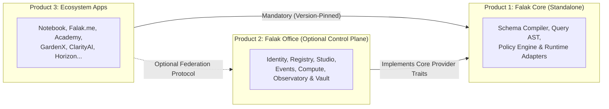
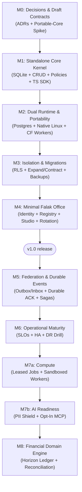

# Falak Framework: Architecture & Execution Plan

**Status: design baseline, draft 4.** No specification is frozen and no runtime code exists yet. Items marked *Proposed* depend on a decision in §3 that has not been accepted.

## 1. Core Strategy: Build Incrementally, Freeze Contracts When Proven

**Falak Framework** (`falak` CLI + **Falak Office**) is a metadata-driven application framework and optional federated control plane. Development is split into **three independently versioned products** built across **nine acceptance-gated milestones (`M0`–`M8`)**.



### Guiding Rules
1. **Strict dependency inversion.** `Falak Core` defines replaceable provider traits (§4.3). Standalone apps use local or third-party implementations; federated apps plug in `Falak Office` without changing application code.
2. **Constrained v1 stack, two runtimes.** A portable Rust core is shared. The native adapter uses **Axum + Tokio + SQLx** with PostgreSQL or SQLite. The edge adapter uses **`workers-rs`** with Cloudflare D1. Frontends and SDKs are **React + TypeScript**. Swift sync, ClickHouse and multi-language handler runtimes are deferred until an app requires them.
3. **Gates and budgets.** Advancing a milestone requires passing its automated gate against a real validation app. Each milestone also has a time budget; when the budget runs out, scope is cut, not the gate.
4. **Integrate commodity infrastructure.** OIDC providers, OpenBao/KMS, SQL queues and OpenTelemetry sit behind Falak's traits. Falak does not reimplement cryptography or identity internals.
5. **Protection ships with the thing it protects.** Isolation tests, telemetry and backups arrive with the first data; key rotation and audit logging arrive with the first keys and the first admin UI.
6. **Default deny.** Missing policy, missing session context or an unknown field is a rejection, never a pass.

---

## 2. Non-Goals

* A general-purpose backend-as-a-service for arbitrary schemas defined at runtime. Schemas are Git-tracked and compiled.
* Hiding driver differences. Capabilities are declared and checked; apps opt in to driver-specific features.
* Building an identity provider, a message broker or a KMS.
* Supporting handler languages other than Rust in v1.
* Offline sync in v1.

**To be written by the project owner:** a short statement of why existing tools (for example Supabase, PocketBase, Directus, Hasura, Frappe) do not meet the need. The answer defines scope and belongs here.

---

## 3. Open Decisions

Each decision becomes an ADR in `specifications/adr/` during `M0`. All positions below are **proposed, not accepted**. A-1 to A-3 block the schema specification.

| ADR | Question | Proposed position |
| :-- | :-- | :-- |
| A-1 | Interpreted runtime or generated code | `falak build` compiles YAML to a validated, content-hashed intermediate representation (IR). A generic runtime loads the IR and never parses YAML. |
| A-2 | How custom handlers are written | Declarative commands for the common case. Custom logic is a Rust crate linked into the app against a small handler API that exposes only the policy-checked data layer. |
| A-3 | Tenancy model | Declared in `app.yaml`: `none`, `row` or `database` (§4.5). |
| A-4 | Build or wrap the identity provider | Wrap an existing open-source OIDC provider; add only app audiences, App Passports and trust-tier claims. |
| A-5 | Shape of Falak Office | A modular monolith: one binary, one PostgreSQL database, built on Falak Core. |
| A-6 | Event store | PostgreSQL only in v1. NATS remains possible behind `EventPublisher`. |
| A-7 | Policy language staging | Ownership and roles in `M1`; attribute rules and field masks in `M3`; relationship rules with bounded depth in `M4`. |
| A-8 | Release cut line | v1.0 is `M1`–`M4`. Later milestones start when their validation app is wanted. |

---

## 4. Target Architecture

### 4.1 Developer-Facing Application Structure
Every project created with `falak init` uses a Git-tracked layout that separates domain correctness from UI presentation:

```text
my-app/
├── app.yaml              # App manifest, tenancy mode, driver capability requirements & trust tier
├── entities/             # Declarative entities, fields, relations, lifecycle & admin presentation metadata
├── policies/             # Ownership, role, attribute, relationship & field-level rules
├── commands/             # Explicit domain mutations & custom business handlers
├── workflows/            # Finite state machines & approval gates
├── events/               # Versioned published/subscribed event contracts & saga compensations
├── jobs/                 # Asynchronous tasks & schedules
├── migrations/           # Generated expand-and-contract SQL migrations
├── frontend/             # Decoupled Next.js / React UI
└── falak.lock            # Pinned framework, IR, spec, driver & schema versions
```

YAML files use a strict subset: unknown keys, duplicate keys, anchors and implicit type coercion are rejected, and every file carries a `schema_version`. JSON Schema is published for each file type so editors validate and autocomplete.

### 4.2 Portable Core and Runtime Adapters
* **Portable semantic core.** Schema AST, input validation, policy compiler, parameterized Query AST and PII pseudonymization live in a crate that performs no I/O, has no Tokio dependency and builds for both native targets and `wasm32`. CI builds both on every change.
* **Compile once.** Policies, queries and the OpenAPI 3.1 document are compiled at build time into SQL templates in the IR *(Proposed, A-1)*. Requests bind parameters only.
* **Native adapter.** Axum + Tokio + SQLx, for PostgreSQL and SQLite.
* **Edge adapter.** `workers-rs` with D1 bindings, held to a WASM size budget and the platform's CPU-time limit.
* **Build-time verification.** The compiler rejects an app whose requirements, queries or commands exceed the chosen driver's capability profile.

### 4.3 Provider Traits
| Trait | Purpose |
| :-- | :-- |
| `StorageDriver` | Database access under a declared capability profile |
| `IdentityProvider` | Authenticate callers and verify tokens |
| `SigningKeyProvider` | Sign and verify; every key has a `kid` and an overlap period |
| `EncryptionKeyProvider` | Envelope encryption (KEK and per-tenant DEK) |
| `EventPublisher` | Publish outbox events |
| `JobDispatcher` | Enqueue and lease jobs |
| `TelemetryExporter` | Logs, traces and metrics, with PII fields redacted |
| `AdminProvider` | Admin surface integration |
| `ObjectStore` | S3-compatible and R2 presigned transfers |
| `Clock`, `IdGenerator` | Injected for deterministic tests |

### 4.4 Driver Capability Profiles
Each driver declares:

* **Transactions:** `interactive_transactions`, `atomic_batch`, `savepoints`, `serializable_isolation`
* **Concurrency:** `concurrent_writers`, `row_level_locking`, `advisory_locks`, `read_replicas`
* **Features:** `native_rls`, `returning`, `upsert`, `json_operators`, `full_text_search`, `vector_search`
* **Limits:** maximum bound parameters, statement size, database size and row size

Expected profiles, to be confirmed in `M0` against current vendor documentation:

| Driver | Notable properties |
| :-- | :-- |
| PostgreSQL | Interactive transactions, concurrent writers, row locking, native RLS |
| SQLite | Interactive transactions, single writer, no RLS |
| Cloudflare D1 | Atomic batches only, no interactive transactions, no RLS, tight limits |

Commands that read then write compile to a conditional batch with a version column on drivers without interactive transactions, or the build rejects them.

### 4.5 Tenancy *(Proposed, A-3)*
| Mode | Meaning | Enforcement |
| :-- | :-- | :-- |
| `none` | Rows are owned by users | Ownership policy |
| `row` | Every tenant-scoped entity carries `tenant_id` | Policy on all drivers, plus RLS on PostgreSQL |
| `database` | One database per tenant | Physical separation; recommended for sensitive apps on SQLite and D1 |

### 4.6 Federation Trust Tiers
| Control | Tier 1 Standard | Tier 2 Sensitive | Tier 3 High assurance |
| :-- | :-- | :-- | :-- |
| Example apps | Falak.me, Digital Notebook | Academy, ClarityAI | Horizon, ThreatWeaver |
| Token verification | Local, cached JWKS | Local, cached JWKS | Local plus online check per sensitive command |
| Access token lifetime | ≤ 15 min | ≤ 5 min | ≤ 5 min, sender-constrained (DPoP) |
| Revocation | By expiry | Signed deny-list feed with bounded staleness | Online, fail closed |
| Sensitive actions | None extra | Step-up authentication; read audit on sensitive fields | Per-transaction passkey assertion over the transaction hash; optional dual approval |
| When Office is down | Works until refresh is needed | Works until the deny-list is stale, then read-only | Sensitive commands stop, by design |

All tiers: `Ed25519` signatures with the algorithm pinned to EdDSA; `iss`, `aud`, `exp` and `kid` required; one audience per app; `nbf` and `iat` honoured with bounded clock skew; JWKS fetched only over verified TLS from the configured issuer, with rate-limited refetch on unknown `kid`; refresh-token rotation with reuse detection that revokes the token family. Login flows use authorization code with PKCE, exact redirect-URI matching, and `state` and `nonce`. The Tier 2 deny-list is signed and carries a monotonic version, so an old or withheld list is detected and treated as stale.

### 4.7 Security Boundaries & Data Isolation
* **Identity and tenant context:** the subject and tenant come only from a verified token and a server-side membership check. A tenant or user identifier supplied in a header, query string or body is never trusted as context.
* **Three-level SQL execution boundary** (levels, to avoid confusion with trust tiers):
  1. Parameterized Query AST (default path).
  2. Parameterized restricted SQL (explicit escape hatch). Each statement is a named file in the repository, compiled into the IR and never accepted at runtime. It is a single, read-only statement with bound parameters only and no string building, checked by a SQL parser at build time. On drivers without `native_rls`, it reads only through generated policy-filtered views, or is rejected for apps in `row` tenancy.
  3. Privileged migration-only role (isolated to `falak migrate`). Its credentials exist only in the deploy pipeline, never in the runtime environment.
* **Custom handlers are trusted code.** A linked Rust handler runs in-process and could bypass any check, so the boundary is review, not sandboxing. The handler API hands out only the policy-checked data layer, never a raw connection; handler crates forbid `unsafe`; handler changes require code review.
* **PostgreSQL RLS:** generated `CREATE POLICY` with both `USING` and `WITH CHECK`; `FORCE ROW LEVEL SECURITY`; a runtime role that owns nothing and has no `BYPASSRLS`; context set per transaction with `set_config(..., true)`; missing context denies; no `SECURITY DEFINER` in generated SQL. The build fails if any tenant-scoped or owner-scoped table lacks a policy, and a conformance test queries the live database to confirm RLS is enabled and forced on each one.
* **Input and output:** request bodies have size, nesting-depth and array-length limits; strings are validated as UTF-8 and normalised before comparison. Error responses never include SQL, stack traces or internal identifiers. Responses carrying user data are sent `Cache-Control: no-store` unless the entity is declared public, and edge caches never share a response across identities.
* **Idempotency keys** are scoped to the calling identity and command, so one caller cannot replay or probe another's request.
* **Authorization side channels:** no filtering, sorting or aggregating on unreadable fields; relation traversal re-checks policy; unknown or unwritable input fields are rejected; invisible rows return 404.
* **Migrations:** expand-and-contract, roll-forward by default, with `falak migrate plan` showing SQL, lock impact and destructiveness. PostgreSQL uses `lock_timeout`, concurrent index builds, `NOT VALID` constraints and batched backfills; SQLite and D1 use planned table rebuilds. An advisory lock prevents concurrent runs; applied migrations are checksummed; drift is detected; the contract phase waits for evidence that no old-version client remains.
* **Object storage:** size and type enforced in presign conditions, magic-byte sniffing after upload, quarantine prefix until checked, server-generated keys under a tenant prefix, user content served from a separate origin as attachments, short presign lifetimes.
* **Web surface:** per-identity and per-IP rate limits, request size and time limits, strict CORS, security headers. Studio uses a backend-for-frontend with `HttpOnly` cookies and CSRF protection.
  Cookies are `Secure`, `HttpOnly` and `SameSite`. Studio sets a strict Content-Security-Policy and escapes all record content, since it renders data written by users of other apps.
* **Local identity (standalone apps):** passwords hashed with Argon2id, login attempts rate-limited with progressive delay, session tokens random and stored hashed, sessions revocable, and password reset by single-use, short-lived token. Passkeys are supported from the start.
* **App-to-Office channel:** apps authenticate to Office with an asymmetric key registered at enrollment (no shared secrets). Enrollment tokens are single-use and short-lived. Requests carry a timestamp and unique identifier and are rejected on replay. App Passports can be revoked, and revocation reaches apps through the same feed as token revocation.
* **Secrets:** never in `app.yaml`, the IR or Git; configuration refers to secrets by name and the runtime resolves them from the platform secret store. CI runs secret scanning. Logs and traces never contain tokens, keys, passwords or fields the schema marks as PII.
* **Encryption:** TLS with certificate verification on every connection, including database connections. Storage is encrypted at rest. Fields the schema marks `encrypted` use envelope encryption with the tenant DEK. Backups are encrypted with a key held separately from the database credentials, and access to them is logged.
* **Outbound requests:** handlers, jobs and upload fetches may call only hosts on a declared allow-list. Private, loopback, link-local and cloud-metadata addresses are blocked after DNS resolution, and redirects are re-checked.
* **Admin access:** Studio reaches app data only through each app's API and policy engine, never by direct database access. Admin roles are granted per app. Impersonation and break-glass access are time-limited, need a stated reason, raise an alert and are fully audited; break-glass for Tier 3 apps needs a second approver.
* **Audit log:** append-only for the runtime role. It records authentication events, policy denials, admin actions, key operations, migrations and break-glass use. Hash chaining and external anchoring make tampering evident.
* **Supply chain and releases:** `cargo-deny` and `cargo-audit` in CI, committed lockfile, declared minimum Rust version, CI actions pinned by commit hash, protected release branch with required review, signed release artefacts with an SBOM, signed IR verified at deploy. A `SECURITY.md` states how to report a vulnerability.

### 4.8 Federation & Durable Cross-App Events
* **Guarantee:** at-least-once delivery, ordered per aggregate, deduplicated by the inbox in the same transaction as the side effect. External side effects carry an idempotency key.
* **Transactional outbox / inbox:** apps write `_office_outbox` and `_office_inbox` atomically within business transactions.
* **Durable acknowledgment:** `Office Events` persists the event and its delivery targets before returning `ACK`.
* **Relay:** a Tokio task on the native runtime; Cron Triggers or Queues on Workers.
* **Ordering & replay:** aggregate revisions are tracked separately from subscriber delivery sequences, with dead-letter replay.
* **Contracts:** event schemas are versioned and checked for compatibility at build time. Outbox and inbox have retention and pruning, poison-message handling and back-pressure limits.
* **Event security:** each event is signed by its publishing app and verified on receipt. Office delivers an event only to apps the publisher's contract authorises as subscribers. Consumers validate the payload against the contract version before acting. Contracts mark PII fields; events carry identifiers in place of PII wherever the consumer can look the data up under its own policy.
* **Saga orchestrator:** opt-in, for multi-app workflows that need compensation.
* **Store:** PostgreSQL *(Proposed, A-6)*.

### 4.9 Operations, Compute, AI Readiness & Financial Engine
* **Observatory & Vault:** OpenTelemetry tracing, liveness and readiness endpoints, `/v1/_office/health`, SHA-256 hash-chained audit logs with external anchoring, rotation of signing keys, app credentials and tenant DEKs, and `pgBackRest`/`WAL-G` and Litestream backups to R2.
* **Runtime resilience:** timeouts on every external call, retries with jitter and a budget, graceful shutdown, one error taxonomy across runtimes.
* **Heavy compute (`Office Compute`):** outbound-only Coolify workers lease jobs with a visibility timeout and heartbeat. Each job runs in a non-root container with CPU, memory and time limits, no network unless an egress allow-list grants it, hash-verified `uv` dependencies and a short-lived job-scoped credential. Completion is idempotent; exhausted retries are dead-lettered. Each worker has its own revocable credential. Job payloads are validated against the job contract, and job results are treated as untrusted input by the app that receives them.
* **AI readiness:** schema-level PII pseudonymization (`<PERSON_1>`, `<IBAN_1>`) with NER scanning, treated as defence in depth and not a guarantee. The mapping table is encrypted and tenant-scoped. MCP projections are opt-in, run as the calling user through the policy engine, are read-only by default, size-limited and audited, with human approval for writes. Model output and retrieved document content are untrusted input: they never widen permissions, and they cannot trigger a write or an outbound request without approval.
* **Data lifecycle:** per-entity retention, soft delete, subject export and subject erasure. Per-tenant DEKs make tenant deletion a key deletion.
* **Financial engine (`Horizon`):** an app, not part of Office; Office routes commands and never holds ledger state. Immutable `JournalEntries` and `Postings` in integer minor units, with $\forall c \in C,\; \sum D_c = \sum C_c$ enforced under PostgreSQL `SERIALIZABLE` isolation with bounded retries. Immutability is enforced in the database (no `UPDATE`/`DELETE` grant on posted tables; deferred balance constraint) as well as in the framework. Idempotency keys are a unique `(scope, key)` row storing the payload fingerprint. Amounts use checked arithmetic that rejects overflow, and a posting whose currency differs from its account's is rejected.
* **Offline sync:** Swift SDK and Hybrid Logical Clock delta-sync, outside the numbered roadmap until an app requires it.

---

## 5. Normative Specifications

Six specifications live in `specifications/`:

1. `SCHEMA_SPECIFICATION.md`: grammar, strict YAML subset, primitive types (`uuid`, `int64`, `decimal_minor`, `timestamptz`), relations, domain primitives, tenancy, lifecycle and admin metadata.
2. `AUTHORIZATION_SPECIFICATION.md`: policy language, default-deny semantics, side-channel rules and SQL compilation.
3. `DRIVER_SPECIFICATION.md`: provider traits, capability profiles and limits, transaction and retry contracts.
4. `API_SPECIFICATION.md`: keyset pagination, filter and include limits, problem-details errors, idempotency keys, `ETag`/`If-Match` concurrency, deprecation policy.
5. `FEDERATION_SPECIFICATION.md`: `/v1/_office/*` API, App Passports, durable acknowledgment, event contracts and sagas.
6. `THREAT_MODEL.md`: trust tiers, replay prevention, key rotation and break-glass recovery. A living document, reviewed at every gate.

**Lifecycle:** draft → candidate → frozen. A spec freezes only after an implementation has exercised it. Frozen specs use semantic versioning and change only by ADR.

| Spec | Frozen at |
| :-- | :-- |
| SCHEMA, AUTHORIZATION, DRIVER, API | `M2` exit |
| FEDERATION | `M5` exit |
| THREAT_MODEL | Never; versioned per gate |

---

## 6. Testing Strategy

* **Negative isolation tests from `M1`:** every generated endpoint is called as the wrong user and the wrong tenant, for every validation app.
* **Fuzzing** of the YAML parser, policy compiler and Query AST.
* **Differential tests:** the same operations on all three drivers, results compared.
* **Snapshot tests** on generated SQL and OpenAPI.
* **Mutation tests** on the policy compiler: a weakened policy must fail a test.
* **Fault injection** for events and jobs: the process is killed at each step; no loss and no duplicate effect.
* **Performance gates in CI:** idle memory, cold start, p50 and p99 latency per driver, and WASM size, each with a written method and a failing threshold.

Targets to set in `M0` (starting proposals): RPO ≤ 5 min and RTO ≤ 1 h for PostgreSQL apps; `< 25 MB` idle memory for the Notebook binary; `< 15 ms` p99 edge latency with the measurement method stated.

---

## 7. Versioning & Upgrade Policy

* The three products are versioned independently with semantic versioning.
* `falak.lock` pins framework, IR, spec, driver and schema versions.
* `falak upgrade` reports breaking changes before applying them.
* A support window for previous minor versions is stated at v1.0.

---

## 8. Milestone Roadmap (`M0`–`M8`)



### M0: Decisions & Draft Contracts
* **Goal:** Make the foundational decisions and prove the largest technical risk before any contract is fixed.
* **Scope:** Git repository, CI, supply-chain checks; ADRs A-1 to A-8; draft SCHEMA, AUTHORIZATION, DRIVER and API specs; threat model v1; numeric RTO, RPO and performance targets; verified Cloudflare Workers and D1 limits.
* **Exit Gate:** All ADRs accepted. A spike shows the portable core building for native and `wasm32` and serving one entity from SQLite and from D1 within the size budget.

### M1: Standalone Core Kernel
* **Goal:** A minimal Rust kernel and `falak` CLI that run a complete standalone app with no dependency on Falak Office.
* **Scope:** Strict YAML parser with file-line-column diagnostics, typed AST, IR build, `falak.lock`, SQLite driver (WAL, `busy_timeout`, `BEGIN IMMEDIATE`, one writer plus a reader pool), REST + OpenAPI 3.1 endpoints, input validation, parameterized Query AST with cost limits, ownership and role policies, hardened local identity (§4.7) and key providers, secret references, TypeScript SDK codegen (`falak sync`), `falak check` / `dev` / `doctor`, negative isolation tests, telemetry, Litestream backups.
* **Validation App:** **Digital Notebook / Todo** in a single binary with user isolation.
* **Exit Gate:** Notebook runs end to end with no external service. The isolation suite passes. Memory and latency benchmarks pass in CI.

### M2: Dual Runtime & Database Portability
* **Goal:** Prove identical schema compilation and execution on Linux servers and Cloudflare's edge.
* **Scope:** Native runtime + PostgreSQL driver (`SQLx` pooling), edge runtime + D1 batched driver with conditional-batch commands, extended capability profile and build-time validator, `conformance/` and differential suites.
* **Validation App:** **Digital Notebook** deployed to Workers + D1 and to Docker + PostgreSQL with zero schema changes.
* **Exit Gate:** Conformance and differential suites pass on SQLite, D1 and PostgreSQL. SCHEMA, AUTHORIZATION, DRIVER and API specs frozen at 1.0.

### M3: Isolation & Migration Lifecycle
* **Goal:** Harden data isolation and schema evolution before multi-user production apps connect.
* **Scope:** PostgreSQL RLS as in §4.7, tenancy modes, attribute rules and field masks, side-channel rules, three-level SQL boundary on every driver, outbound allow-list, `falak migrate` with `plan`, upload hardening, rate limits, PostgreSQL backups, `falak policy test` / `explain`.
* **Validation App:** **Falak.me** (portal, user profiles, file assets).
* **Exit Gate:** Automated cross-tenant penetration tests show zero leakage across Query AST, RLS and restricted SQL on every driver. A restore from backup is demonstrated.

### M4: Minimal Falak Office
* **Goal:** Launch Falak Office on Coolify so multiple apps share one login and one admin interface.
* **Scope:** `Office Identity` *(Proposed, A-4: wraps an existing OIDC provider)* with passkeys, `Ed25519` JWTs, refresh rotation and cached JWKS; `Office Registry` with cryptographic enrollment and signed App Passports; `Office Studio` generated from `admin:` metadata with step-up scopes, PII masking, accessibility and localisation; signing-key rotation with overlap; hash-chained audit log; relationship rules with bounded depth; documented and tested outage behaviour per tier. FEDERATION spec reaches candidate.
* **Validation Apps:** **Digital Notebook**, **Falak.me**, **Academy**.
* **Exit Gate:** Single sign-on works across all three apps. Studio manages records in two unrelated apps with no custom dashboard code. A signing key is rotated with no failed requests. Apps behave as specified with Office stopped.

**v1.0 release** *(Proposed, A-8)*.

### M5: Federation & Durable Cross-App Events
* **Goal:** Loose, fault-tolerant cross-app communication without synchronous coupling.
* **Scope:** Everything in §4.8, plus fault-injection tests.
* **Validation App:** **GardenX** (marketplace orders and inventory).
* **Exit Gate:** Killing `Office Events` or a consumer at any step produces no lost event and no duplicate side effect. FEDERATION spec frozen.

### M6: Operational Maturity
* **Goal:** Unattended multi-app hosting.
* **Scope:** Service-level objectives and alerting, Office high availability, external audit anchoring, credential and DEK rotation, full disaster-recovery drill, break-glass CLI procedures.
* **Validation App:** **DataMan** (cross-app analytics and schema introspection).
* **Exit Gate:** A disaster-recovery drill restores database state and rotates compromised app credentials within the RTO and RPO set in `M0`.

### M7a: Heavy Compute
* **Goal:** Run heavy Python/GPU workloads without bloating the edge core.
* **Scope:** `Office Compute` as in §4.9.
* **Validation Apps:** **SecuraBlock** (isolated security scans), **ClarityAI** (document pipeline).
* **Exit Gate:** Multi-minute jobs run on Coolify workers with zero open inbound ports while edge latency stays within budget. A job whose worker is killed completes exactly once in effect.

### M7b: AI Readiness
* **Goal:** Support AI agent workflows under the same policy engine as every other caller.
* **Scope:** PII pseudonymization, NER scanning, AI egress policies, opt-in MCP projection with allowlists and human approval.
* **Validation Apps:** **ClarityAI** (PII shield), **PulseAI** (digests, read-only MCP), **ThreatWeaver** (anomaly detection, online revocation).
* **Exit Gate:** A prompt-injection test set cannot read or write outside the caller's policy.

### M8: Financial Engine (*Horizon* & *BlockBanking*)
* **Goal:** High-assurance double-entry accounting, after isolation, security and audit are proven.
* **Scope:** `Horizon` as in §4.9, domain commands (`transfer`, `reserve`, `capture`, `release`, `reverse`, `settle`, `reconcile`), Tier 3 controls, and *GardenX* and *Academy* checkouts through Horizon's federated commands and compensating sagas.
* **Validation Apps:** **Horizon** and **BlockBanking**.
* **Exit Gate:** Concurrent double-spend stress tests, serialization-retry chaos tests and external statement reconciliation pass with zero discrepancy.
* **Before starting:** BlockBanking may involve regulated activity. Take legal advice first; it can change requirements.

---

## 9. Validation App Sequence

A validation app is the thinnest vertical slice that exercises its milestone's features. Growing one into a full product is a separate decision.

| # | App | Milestone | Proves |
| :-- | :-- | :-- | :-- |
| 1 | Notebook / Todo | `M1`–`M2` | Core and portability |
| 2 | Falak.me | `M3`–`M4` | Isolation and SSO |
| 3 | Academy | `M4` | Workflows and Studio |
| 4 | GardenX | `M5` | Outbox and events |
| 5 | DataMan | `M6` | Analytics and observability |
| 6 | SecuraBlock | `M7a` | Isolated workers |
| 7 | ClarityAI | `M7a`–`M7b` | Compute and PII shield |
| 8 | PulseAI | `M7b` | Digests and MCP |
| 9 | ThreatWeaver | `M7b` | Telemetry and revocation |
| 10 | Horizon / BlockBanking | `M8` | Double-entry ledger |

---

## 10. Immediate Next Actions (`M0`)

1. Initialise Git and commit the current documents.
2. Decide ADRs A-1 to A-8, starting with A-1, A-2 and A-3.
3. Verify Cloudflare Workers and D1 limits and record them in the DRIVER draft.
4. Run the portable-core spike on SQLite and D1.
5. Set the numeric targets in §6.
6. Create the `falak/` monorepo skeleton (`specifications/`, `crates/`, `packages/`, `office/`, `conformance/`) with CI, supply-chain checks, secret scanning, dual-target builds and a `SECURITY.md`.
7. Draft the SCHEMA, AUTHORIZATION, DRIVER and API specs and threat model v1.
8. Begin **M1**.

---

## 11. Glossary

| Term | Meaning |
| :-- | :-- |
| ADR | Architecture decision record: one short document per decision |
| App Passport | Signed manifest an app presents to Office to prove its identity and declared capabilities |
| Capability profile | A driver's declared features and limits, checked at build time |
| DEK / KEK | Data-encryption key, and the key-encryption key that wraps it |
| Expand-and-contract | A migration in two phases: add the new shape, then remove the old one once nothing uses it |
| IR | Intermediate representation: the compiled, hashed form of an app's YAML that the runtime loads |
| Outbox / inbox | Tables that record events to send and events already handled, written in the same transaction as the business change |
| RLS | PostgreSQL row-level security |
| Tenant | The unit of data isolation declared by an app's tenancy mode |
| Trust tier | One of three sets of federation controls an app declares (§4.6) |
| Validation app | A thin application used to prove a milestone's gate |
