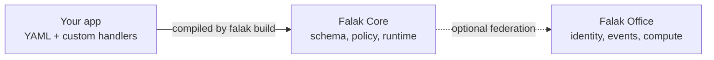

# Falak Framework: Architecture

Falak is a framework for data-driven applications. An app is described in YAML files kept in Git: entities, access policies, commands and, optionally, events and jobs. The `falak` CLI compiles those files into a validated intermediate representation (IR), and a generic runtime serves the IR as an HTTP API. Every request is checked against the policy before any data is read or written.

**Status:** the schema, authorization, driver and API specifications are frozen at 1.0 (ADR-0009). Federation is versioned separately. The release history is in [CHANGELOG.md](./CHANGELOG.md).

## 1. Components

Falak has two parts, versioned separately:

* **Falak Core.** The schema compiler, the query engine, the authorization engine and the runtime adapters. An app built on Core runs on its own, with no other service.
* **Falak Office (optional).** Shared sign-in for several apps, an app registry, key rotation and revocation, durable events between apps, compute workers, and a key vault. It also serves Falak Studio, a generated admin interface for each app.

Apps that run on Core can join an Office installation without changes to their code.



## 2. Design principles

1. **Default deny.** A missing policy, a missing session or an unknown field is a rejection, never a pass.
2. **Compile once.** Policies, queries and the OpenAPI document are built ahead of time. Requests bind parameters only.
3. **Declare what the driver can do.** Each database driver declares its capabilities. The build fails if an app needs something the chosen driver lacks.
4. **Use commodity infrastructure.** OpenID Connect providers, KMS, object storage and telemetry sit behind provider traits. Falak does not reimplement cryptography or identity internals.
5. **Protection ships with the data.** Tenant isolation, audit logging and backups are part of the runtime, not add-ons.
6. **Keep the framework generic.** Domain logic such as payments, ledgers or other regulated flows belongs in applications, which extend the framework through custom command handlers.

## 3. Repository and app layout

A Falak app is a directory of YAML files:

```text
my-app/
├── app.yaml          # name, version, tenancy, trust tier, drivers
├── entities/         # one file per entity: fields, relations, lifecycle, admin metadata
├── policies/         # one file per entity: who may read, create, update, delete
├── commands/         # named mutations beyond plain CRUD
├── events/           # optional: published and subscribed event contracts
├── workflows/        # optional: sagas across apps
├── migrations/       # generated, never edited by hand
└── falak.lock        # generated by falak build; committed
```

YAML is a strict subset: unknown keys, duplicate keys, anchors and implicit type coercion are rejected, and every file carries `schema_version: 1`. The rules are in [SCHEMA_SPECIFICATION.md](./specifications/SCHEMA_SPECIFICATION.md).

## 4. Runtime

* **Native runtime.** Axum and Tokio with SQLx. Serves PostgreSQL or SQLite.
* **Edge runtime.** `workers-rs` on Cloudflare Workers, with D1. It is held to a WASM size budget and the platform's CPU limits.
* **Portable core.** The schema, validation and policy compiler live in a crate with no I/O. It builds for native targets and for `wasm32`, and CI checks both.

### 4.1 Drivers

| Driver | Transactions | Concurrency | Row-level security |
| :-- | :-- | :-- | :-- |
| PostgreSQL | Interactive | Concurrent writers, row locking | Native RLS |
| SQLite | Interactive | Single writer | No |
| Cloudflare D1 | Atomic batches only | Single writer | No |

On a driver without interactive transactions, a command that reads and then writes compiles to a conditional batch with a version column, or the build rejects it. The full capability model is in [DRIVER_SPECIFICATION.md](./specifications/DRIVER_SPECIFICATION.md).

### 4.2 Tenancy

| Mode | Meaning | Enforcement |
| :-- | :-- | :-- |
| `none` | Rows belong to users | Ownership policy |
| `row` | Every row carries `tenant_id` | Policy on all drivers, plus RLS on PostgreSQL |
| `database` | One database per tenant | Physical separation; recommended for sensitive apps on SQLite and D1 |

### 4.3 Provider traits

Storage, identity, signing keys, encryption keys, events, jobs, telemetry, object storage, and clocks and ID generators are all traits. Standalone apps use local implementations. Office supplies the federated ones.

## 5. Security

* **Identity and tenant context.** The subject and tenant come only from a verified token and a server-side membership check. A tenant or user identifier in a header, query string or body is never trusted.
* **Authorization.** Ownership, role and authenticated rules, compiled into the runtime. On PostgreSQL the same rules are enforced again by generated row-level security policies with `FORCE ROW LEVEL SECURITY`, and the runtime role owns nothing and cannot bypass RLS. A conformance test queries the live database to check this. Full rules are in [AUTHORIZATION_SPECIFICATION.md](./specifications/AUTHORIZATION_SPECIFICATION.md).
* **Side channels.** No filtering, sorting or aggregating on unreadable fields. Invisible rows return 404, never 403. Relation traversal re-checks policy.
* **SQL escape hatch.** Restricted SQL is named files in the repository, checked at build time, read-only and bound-parameter only. It is never accepted at runtime.
* **Custom handlers are trusted code.** A linked Rust handler runs in-process, so the boundary is code review. The handler API exposes only the policy-checked data layer, never a raw connection, and handler crates forbid `unsafe`.
* **Input and output.** Size, depth and array limits on request bodies. Errors never include SQL, stack traces or internal IDs. Responses with user data are `Cache-Control: no-store` unless the entity is public.
* **Idempotency keys** are scoped to the calling identity and command.
* **Local identity.** Passwords are hashed with Argon2id. Session tokens are random and stored hashed. Sessions are revocable. Login is rate-limited.
* **Outbound requests** may reach only hosts on a declared allow-list. Private, loopback, link-local and cloud-metadata addresses are refused after DNS resolution, and redirects are re-checked. This is [falak-egress](./crates/falak-egress).
* **Migrations.** Expand-and-contract by default. `falak migrate plan` shows the SQL, lock impact and whether anything is destructive before anything runs. Applied migrations are checksummed, and drift is detected.
* **Audit log.** Hash-chained and append-only for the runtime role. It records sign-ins, policy denials, admin actions, key operations and migrations.
* **Secrets** never live in `app.yaml`, the IR or Git. Configuration names a secret and the runtime resolves it from the platform's store.
* **Supply chain.** `cargo-deny` and `cargo-audit` run in CI. The lockfile is committed. CI actions are pinned by commit hash. Release artefacts are signed, with an SBOM.

## 6. Falak Office

Office is a modular monolith on PostgreSQL, built on Core.

* **Identity and registry.** Apps enrol with an asymmetric key, not a shared secret. Enrollment tokens are single-use. Each app has a passport that can be revoked.
* **Trust tiers.** Each app declares a tier that sets how tokens are checked and how revocation works:

  | Control | Standard | Sensitive | High assurance |
  | :-- | :-- | :-- | :-- |
  | Token verification | Local, cached keys | Local, cached keys | Local, plus an online check per sensitive command |
  | Revocation | By token expiry | Signed deny-list, bounded staleness | Online, fails closed |
  | Sensitive actions | None extra | Step-up sign-in; read audit | Per-transaction passkey; optional dual approval |

  Office does not run high-assurance apps yet; it refuses them.
* **Events.** At-least-once delivery, ordered per aggregate, with an outbox and inbox written in the same transaction as the business change. Office persists an event before it acknowledges it. Events are signed by the publishing app and delivered only to subscribers the contract authorises. Dead-letter replay is supported. The contract is in [FEDERATION_SPECIFICATION.md](./specifications/FEDERATION_SPECIFICATION.md).
* **Compute.** Outbound-only workers lease jobs with a visibility timeout and heartbeat. Each job runs in a non-root container with CPU, memory and time limits, and no network unless an egress allow-list grants it. Completion is idempotent, and exhausted retries are dead-lettered.
* **Operations.** OpenTelemetry tracing, health endpoints, key and credential rotation, and point-in-time restore scripts for PostgreSQL. See [docs/operations.md](./docs/operations.md).

## 7. AI access

`falak-ai` is an MCP server, a Model Context Protocol endpoint, that lets an AI agent call an app's REST API.

* It is opt-in and exposes only the entities the operator lists.
* Each tool call becomes a REST request sent with the signed-in user's own token. The app's policies decide the result. The MCP layer has no credentials of its own.
* Writes are off unless the operator enables them (`FALAK_MCP_WRITES=on`), and they run as the user.

It does not filter personal data. Access control is the app's policy, not a separate gate.

## 8. Specifications

These are normative and frozen where marked above:

1. [`SCHEMA_SPECIFICATION.md`](./specifications/SCHEMA_SPECIFICATION.md): grammar, primitive types, relations, tenancy, lifecycle and admin metadata.
2. [`AUTHORIZATION_SPECIFICATION.md`](./specifications/AUTHORIZATION_SPECIFICATION.md): policy language, default deny, side channels and SQL compilation.
3. [`DRIVER_SPECIFICATION.md`](./specifications/DRIVER_SPECIFICATION.md): provider traits, capability profiles and transaction contracts.
4. [`API_SPECIFICATION.md`](./specifications/API_SPECIFICATION.md): pagination, filters, errors, idempotency, `ETag` concurrency and deprecation.
5. [`FEDERATION_SPECIFICATION.md`](./specifications/FEDERATION_SPECIFICATION.md): the `/v1/_office/*` API, passports, acknowledgement, event contracts and sagas.
6. [`THREAT_MODEL.md`](./specifications/THREAT_MODEL.md) and [`CLOUDFLARE_LIMITS.md`](./specifications/CLOUDFLARE_LIMITS.md).

## 9. Decisions

Each decision is an ADR in [`specifications/adr/`](./specifications/adr/):

| ADR | Decision |
| :-- | :-- |
| [0001](./specifications/adr/ADR-0001-ir-and-runtime.md) | `falak build` compiles YAML to a validated, content-hashed IR. A generic runtime loads it. |
| [0002](./specifications/adr/ADR-0002-custom-handlers.md) | Declarative commands for the common case. Custom logic is a Rust crate linked against the policy-checked data layer. |
| [0003](./specifications/adr/ADR-0003-tenancy.md) | Tenancy is declared in `app.yaml`: `none`, `row` or `database`. |
| [0004](./specifications/adr/ADR-0004-identity.md) | Wrap an existing OpenID Connect provider; do not build an identity provider. |
| [0005](./specifications/adr/ADR-0005-office-shape.md) | Office is a modular monolith on one PostgreSQL database. |
| [0006](./specifications/adr/ADR-0006-event-store.md) | PostgreSQL is the event store in v1. |
| [0007](./specifications/adr/ADR-0007-policy-staging.md) | Policy rules are added in stages: ownership and roles first, then attributes, then bounded relationships. |
| [0008](./specifications/adr/ADR-0008-release-cut.md) | The release cut line for v1.0. |
| [0009](./specifications/adr/ADR-0009-spec-freeze-1-0.md) | The four core specifications are frozen at 1.0. |
| [0010](./specifications/adr/ADR-0010-phase-3-amendments.md) | Amendments from the third phase. |
| [0011](./specifications/adr/ADR-0011-oidc-relying-party.md) | Falak acts as an OpenID Connect relying party. |

## 10. Non-goals

* A general backend-as-a-service for schemas defined at runtime. Schemas are Git-tracked and compiled.
* Hiding driver differences. Capabilities are declared and checked.
* Building an identity provider, a message broker or a key management service.
* Handler languages other than Rust.
* Offline sync.

**Open for the owner:** a short statement of why existing tools (such as Supabase, PocketBase, Directus or Hasura) do not meet the need. It belongs here and is not yet written.
